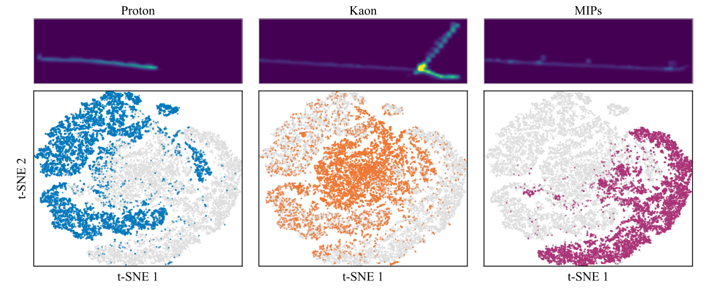
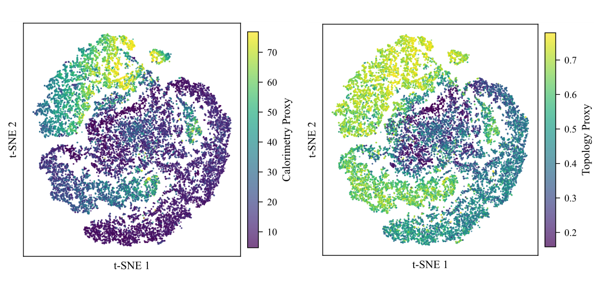
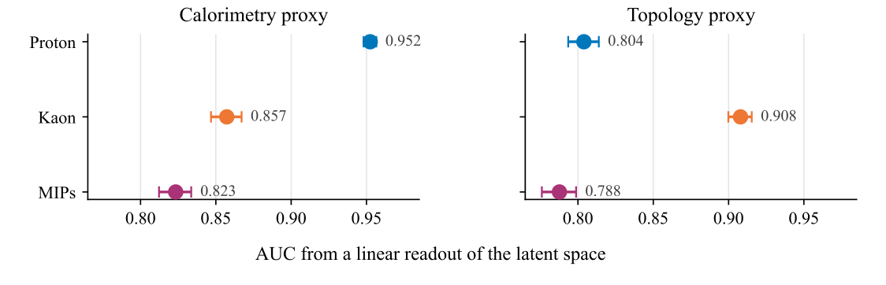
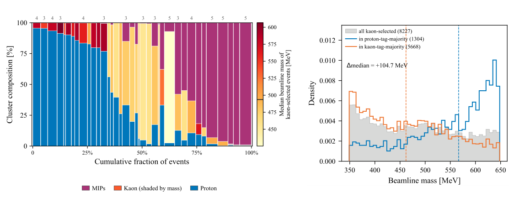

# Unsupervised Particle Separation in a LArTPC

**Can a generative model learn to tell particles apart from real detector images, with no labels in its loss?**

This repository trains a convolutional β-VAE on real data from the [LArIAT](https://doi.org/10.1088/1748-0221/15/04/P04026) liquid argon test-beam experiment. It shows that the 8-dimensional latent space encodes the two physical cues physicists use for particle ID: **calorimetry** (how much energy a track deposits) and **topology** (the shape of the track). Clustering that latent space with no supervision recovers protons, kaons and minimum-ionising particles at **75–87% purity** against the beamline tags. It also isolates proton contamination in the kaon sample, which the training labels could not do.

> 📄 Code for the workshop paper *"Unsupervised particle separation in a LArTPC via interpretable latent representations"*, submitted to the NeurIPS 2026 workshop on **Representations for the Physical Sciences**. LaTeX source: [`output/pdf/rps_2026/`](output/pdf/rps_2026/).


<sub>**Top:** collection-plane images of a stopping proton (rising charge at the endpoint), a kaon (decay with a secondary track) and a MIP (straight, low charge). **Bottom:** t-SNE of all 27,657 latent vectors, highlighting each beamline tag in turn. The model never saw these tags.</sub>

---

## Highlights

| | |
|---|---|
| **First β-VAE trained on real LArTPC data** | Most ML in this field is supervised and trained on simulation, so its performance depends on how well the simulation matches the detector. This model learns only from real detector images. |
| **Physics emerges without being specified** | Linear probes recover calorimetry with AUC up to **0.952** (protons) and topology with AUC up to **0.908** (kaons) from the latent vectors alone. |
| **Label-free clustering** | A Gaussian mixture on the latents gives majority-species purity of **86.6% (p) / 81.9% (MIP) / 75.3% (K)**. Five clusters hold 36% of all kaon candidates at **93.7%** purity. |
| **Finds what the labels miss** | Kaon-tagged events placed in proton-like clusters sit **+104.7 MeV** higher in beamline mass, the signature of proton contamination. The VAE and the GMM never saw the mass. |
| **Robust** | The results hold across 30 training-set sizes (100 to 22k images) and latent dimensions from 4 to 128, each with 3 seeds. |

## Approach

```
Real LArIAT Run II data (positive beam)
  │  10,466 proton · 8,227 kaon · 8,964 MIP candidates, tagged by upstream beamline detectors
  ▼
Cluster extraction → plane matching → quality cuts
  ▼
Image: last 50 wires of the track, collection + induction planes → 2 × 48 × 48, log(1 + ADC)
  ▼
Convolutional β-VAE (4 conv blocks, 8-D latent, β = 0.5, 10× weight on active pixels)
  │  trained on a balanced 9,419-event subset; 18,238 events held out
  ▼
Latent analysis (labels used for evaluation only)
  ├─ logistic probes for calorimetry (mean ADC) and topology (solidity) proxies
  ├─ full-covariance GMM, k = 3 … 50
  └─ beamline-mass test of contamination in the kaon sample
```

Showing the model only the **end of the track** keeps the discriminating physics (the proton Bragg peak, the kaon decay vertex) and stops the model from separating particles by track length alone. The VAE sees only pixels: no track length, no calibrated dE/dx, no beamline tags.

## Results

### The latent space encodes calorimetry and topology

<table>
<tr>
<td width="55%"></td>
<td></td>
</tr>
<tr>
<td><sub>The same t-SNE coloured by mean ADC (calorimetry) and solidity (topology). Neither quantity was used in training.</sub></td>
<td><sub>Out-of-fold AUCs of a linear probe separating events above and below each proxy's median <i>within one species</i>. This rules out the probe simply recovering the particle label.</sub></td>
</tr>
</table>

The pattern matches the physics. Charge is most decodable for **protons**, which have the strongest Bragg-peak variation. Track shape is most decodable for **kaons**, whose decays and interactions vary topology the most.

### Unsupervised clusters recover particle species and expose beam contamination


<sub>**Left:** composition of the k = 37 GMM clusters. Width is proportional to population, and kaon segments are shaded by median beamline mass. **Right:** beamline mass of kaon-tagged events, split by whether their cluster is proton-majority or kaon-majority.</sub>

The kaon tag is a 350–650 MeV beamline-mass window, so finite resolution lets protons (938 MeV) in. A beamline fit estimates ~25% contamination. If the latent space has learned real physics, the kaon-tagged events that look like protons should sit at higher mass. They do:

- Median mass is **566.5 MeV** in proton-majority clusters and **461.9 MeV** in kaon-majority clusters.
- Across clusters, the kaon-sample median mass rises with the proton fraction (Spearman ρ = 0.64). No such trend appears in the purer proton and MIP samples.
- An anchored comparison fit, which does use tags, gives a consistent **+103.4 MeV** shift.

## Repository layout

```
src/                 core library
├── event.py, clustering.py, matching.py, cuts.py   ROOT events → matched 2-plane clusters
├── bethe_bloch.py, chi2.py                         dE/dx hypothesis scoring
├── images.py, transforms.py                        canvas, downsampling, input transforms
├── models/          configurable convolutional VAE + builder
├── losses/          pixel-weighted MSE + β·KL
├── train/           training loop, early stopping, logging, run naming
├── inference/       batched encoding → latents and reconstructions
└── features/        hand-crafted calorimetry and topology observables (evaluation only)

scripts/             end-to-end pipeline
├── dataset.py → image_making.py → run_training.py → run_pipeline.py
├── run_sweep.py     multi-GPU hyperparameter sweeps over SSH
└── extra/           every paper analysis: probes, GMM k-scan, mass tests,
                     beamline fits, capacity/statistics scans, figures

configs/             YAML configs; run_0093_*bal9419* is the paper model
output/              tracked result tables (CSV/JSON) and paper source
```

## Reproducing

The environment is managed with [uv](https://docs.astral.sh/uv/) on Python 3.11. Training runs on CUDA, Apple Silicon (MPS) or CPU, chosen automatically.

```bash
uv sync
```

Train the paper model, then run inference, features and the latent analyses:

```bash
uv run python scripts/run_training.py --config configs/run_0093_all_species_bal9419_vae_latent8_ch32_64_128_256_beta0.5_lr0.001_epoch200_actrelu_kern5_stride2_pad2_hw48x48_txlog1p.yaml
```

```bash
uv run python scripts/run_pipeline.py --config configs/run_0093_all_species_bal9419_vae_latent8_ch32_64_128_256_beta0.5_lr0.001_epoch200_actrelu_kern5_stride2_pad2_hw48x48_txlog1p.yaml
```

Each paper analysis is a standalone script in `scripts/extra/` that takes the same `--config`. For example, `cluster_k_sweep.py` runs the GMM scan, `plot_cluster_mass.py` the mass test, `plot_proxy_auc.py` the probes, and `fit_kaon_peak.py` the beamline contamination fit.

> **Data:** LArIAT detector data is not distributed with this repository. Configs point to local data paths, which you will need to change for your own copy.

## References

- R. Acciarri et al., *The Liquid Argon In A Testbeam (LArIAT) experiment*, JINST 15 P04026 (2020).
- I. Higgins et al., *β-VAE: Learning basic visual concepts with a constrained variational framework*, ICLR 2017.
- D. P. Kingma and M. Welling, *Auto-encoding variational Bayes*, ICLR 2014.
